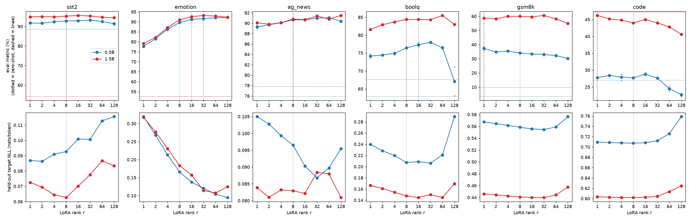
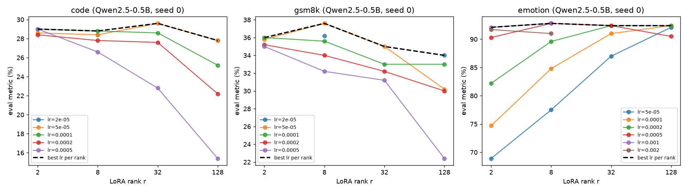
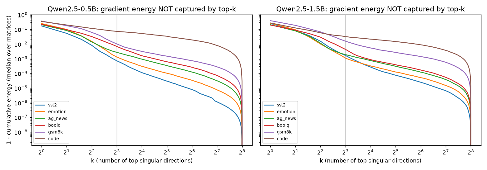
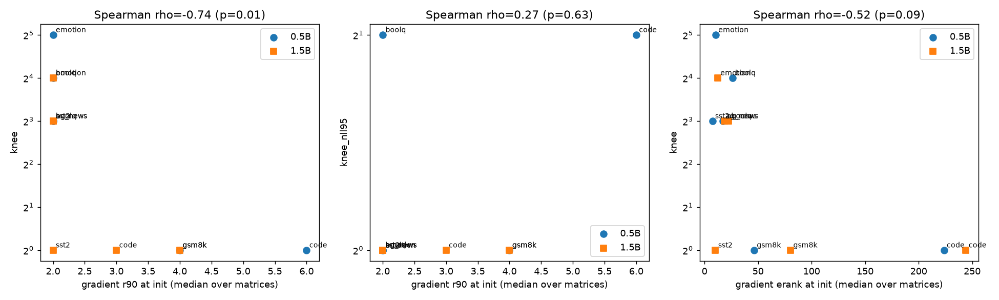

# LoRA Rank Selection Blind Spots — Does the Default Rank Miss Task-Specific Optima?

## 1. Executive Summary

**Question.** Does the best LoRA rank vary widely across tasks (low for sentiment, ≥32 for code), does the common
default r=8 leave 3–8 pp on the table for "high-rank" tasks, does the knee shrink with model size, and does the
effective rank of the full-weight gradient at initialization predict the knee (Spearman ρ > 0.7)?

**Answer (mostly negative).** We ran a controlled sweep: 6 tasks × 8 ranks (1–128) on Qwen2.5-0.5B with 2 seeds,
a single-seed sweep on Qwen2.5-1.5B, and a learning-rate sweep. All runs used the same data budget (4,000 examples,
1 epoch, alpha = 2r), giving **~200 trained adapters**. At the fixed recipe lr (2e-4), the best rank does vary a
lot across tasks (r=1 to r=128). But it varies in the **opposite direction** from the hypothesis. The generative
tasks (GSM8K, Python code) do best at **low** rank and *degrade* above r≈32, falling at r=128 to 30.1% vs 37.3%
(GSM8K) and 22.7% vs 28.8% (code, below the 27.0% zero-shot baseline). The task that "needed" high rank was 6-way
emotion classification. Its gap there is the only rank-8 gap that is significant after Holm correction (+2.6 pp
for 0.5B, +2.2 pp for 1.5B), and it **disappears once the learning rate is tuned per rank**: with lr 5e-4, r=8
reaches 92.8%, matching or beating r=32/128. In this setup, "how much rank a task needs" is largely a proxy for
"how big a step the fixed lr gives at that rank". The gradient-spectrum predictor ranks tasks clearly
(code ≫ GSM8K > BoolQ > AG News > emotion > SST-2), but that ordering is *negatively* correlated with the empirical
knee (ρ = −0.74, permutation p = 0.014, n = 12 task × model pairs). With a leave-one-out calibrated scale it lands
within a factor of 2 of the knee for 0 of 12 pairs, vs 50% for always predicting r=8.

**Practical implication.** For small-model SFT at this data scale, r=8 is not a blind spot. Once the lr is tuned,
r=8 was within noise of the best rank on every task we tested. Sweeping the **learning rate** is worth far more
than sweeping rank: on emotion, lr changed r=8 accuracy by 15 pp vs ≤3 pp from changing rank at the best lr.
Large ranks at a default lr are the actual risk: they caused −7 to −11 pp collapses on BoolQ, GSM8K and code.

## 2. Research Question & Motivation

LoRA recipes almost always hard-code r=8 or 16. If rank needs differed by an order of magnitude between task types,
practitioners would be leaving accuracy on the table, and a cheap predictor of the needed rank would be valuable.
The hypothesis decomposed into:

| ID | Claim | Operationalisation |
|---|---|---|
| H1 | Optimal rank varies ≥8× across tasks (sentiment ≈4, code ≥32) | max/min knee rank per model; direction by task type |
| H2 | r=8 leaves 3–8 pp on high-rank tasks | best-rank − r8 metric, paired bootstrap over eval items, Holm over tasks; cross-fitted across seeds |
| H3 | Knee decreases with model size | knee(1.5B) vs knee(0.5B), same task |
| H4 | Gradient intrinsic dimensionality at init predicts knee within 2× (ρ>0.7) | Spearman over (task, model); leave-one-out scale-calibrated factor-2 hit rate |

**Literature context (from background knowledge; no literature review was pre-gathered for this workspace).**
Hu et al. (2021) reported that very low ranks suffice for GPT-3 adaptation; Aghajanyan et al. (2020) found that the
intrinsic dimension of fine-tuning is low and decreases with model size. Biderman et al. (2024, "LoRA Learns Less and
Forgets Less") found that code/math *continued pre-training* needs high rank. Kalajdzievski (2023, rsLoRA) showed
that the alpha/r scaling couples rank and effective learning rate, and AdaLoRA (Zhang et al. 2023) allocates rank
adaptively. Our study is a controlled SFT-scale test of these claims, and our lr sweep directly probes the rank–lr
coupling.

## 3. Experimental Setup

**Models.** Qwen2.5-0.5B and Qwen2.5-1.5B *base* (same family/tokenizer, so a clean size comparison), bf16 weights.
3B was not feasible: the GPUs were shared, with typically 0.5–6 GB free per GPU.

**Tasks** (all cast as causal-LM SFT with loss only on response tokens):

| task | train source (4,000 ex.) | evaluation set | metric |
|---|---|---|---|
| SST-2 sentiment | GLUE SST-2 train | validation, 872 | accuracy (argmax over label-word first tokens) |
| Emotion (6-way) | dair-ai/emotion train | test, 1,000 sampled | accuracy |
| AG News (4-way) | train | test, 1,000 sampled | accuracy |
| BoolQ | train | validation, 1,000 sampled | accuracy |
| GSM8K | train (calculator annotations stripped) | test, 500 sampled | exact match of final number, greedy, ≤320 new tokens |
| Python code | iamtarun/python_code_instructions_18k_alpaca | MBPP test, all 500 | pass@1: generated code must pass all 3 asserts (subprocess, 10 s timeout) |

All runs also report the **held-out NLL** on target tokens for 300 unseen training-distribution examples.

**LoRA / optimisation (main grid).** Targets: all linear layers (q,k,v,o,gate,up,down). alpha = 2r (the "r=8,
alpha=16" convention; constant scale 2). Dropout 0.05, AdamW lr 2e-4, cosine schedule, 3% warmup, effective batch 16,
1 epoch = 250 steps, max length 512, bf16 autocast, gradient checkpointing, grad-clip 1.0.
Ranks: 1, 2, 4, 8, 16, 32, 64, 128 (0.55M → 70M trainable params on 0.5B; 1.15M → 148M on 1.5B), plus r=0
(zero-shot). Seeds: 0 and 1 for 0.5B (seed controls LoRA init, data order and dropout; the training subset is fixed).
1.5B: seed 0 only.

**Learning-rate sweep (Exp 4).** 0.5B, seed 0, tasks {code, GSM8K, emotion}, ranks {2, 8, 32, 128},
lr ∈ {5e-5, 1e-4, 2e-4, 5e-4}, plus 2e-5 (GSM8K/code r8 & r128) and 1e-3 / 2e-3 (emotion r2 & r8).

**Gradient intrinsic dimensionality (Exp 3).** For each task × model, the full-weight gradient of the mean token
loss at the pretrained weights was accumulated over 128 training examples for all 7 × L target matrices (168 for
0.5B, 196 for 1.5B), and each matrix's singular values were computed. Per matrix we record r50/r90/r99 (number of
directions capturing that fraction of squared Frobenius energy), entropy effective rank (erank), stable rank, and the
top-8 energy fraction. The task-level predictor is the median over matrices; r90 was pre-registered as primary.

**Definitions (pre-registered in planning.md).** *Best rank* = argmax of the seed-mean metric. *Knee* = smallest rank
whose metric is within δ of the best, with δ = max(0.5 pp, SE of the best rank's item mean).
*NLL knee95* = smallest rank achieving 95% of the maximal NLL reduction over zero-shot.

**Statistics.** Paired bootstrap over eval items (5,000 resamples) for the r8 gap, with Holm correction over tasks.
The *cross-fitted gap* picks the best rank on one seed and measures it on the other, which removes winner's-curse
bias. Spearman ρ uses a permutation p-value (5,000 permutations).

**Compute.** 4× RTX A6000 (48 GB), shared with other users' jobs. Our jobs ran in ~2.5–5 GB slices through a custom
memory-aware queue (`src/gpu_queue.py`). Wall-clock per run ranged from 1.5 min (classification, idle GPU) to ~45 min
(1.5B generation tasks on a saturated GPU). Total ≈ 4 h wall-clock. No API costs.
Software: Python 3.12, torch 2.14.1, transformers 5.20.2, peft 0.21.2, scipy 1.18.1, pandas 3.1.0.

## 4. Results

### 4.1 Rank curves (main grid, lr 2e-4)

Seed-mean eval metric (%); 0.5B = mean of 2 seeds, 1.5B = 1 seed. **Bold** = best rank. Seed SDs for 0.5B are
≤1.3 pp everywhere except BoolQ r=128 (5.7 pp).

| model | task | r0 (zero-shot) | r1 | r2 | r4 | r8 | r16 | r32 | r64 | r128 |
|---|---|---|---|---|---|---|---|---|---|---|
| 0.5B | sst2 | 88.5 | 91.7 | 91.7 | 92.4 | 92.8 | 92.9 | **93.3** | 92.5 | 91.5 |
| 0.5B | emotion | 52.6 | 77.7 | 81.6 | 86.3 | 89.7 | 91.2 | 91.7 | 92.1 | **92.3** |
| 0.5B | ag_news | 75.9 | 89.3 | 89.7 | 90.1 | 90.7 | 90.7 | 91.0 | **91.1** | 90.4 |
| 0.5B | boolq | 62.9 | 74.2 | 74.4 | 74.9 | 76.4 | 77.3 | **78.0** | 76.5 | 67.1 |
| 0.5B | gsm8k | 3.4 | **37.3** | 34.8 | 35.4 | 34.1 | 33.4 | 33.0 | 32.3 | 30.1 |
| 0.5B | code | 27.0 | 27.8 | 28.4 | 27.9 | 27.7 | **28.8** | 27.6 | 24.5 | 22.7 |
| 1.5B | sst2 | 54.2 | 95.0 | 95.1 | 95.0 | 95.3 | **95.6** | 95.4 | 94.7 | 94.5 |
| 1.5B | emotion | 52.6 | 79.1 | 82.2 | 87.1 | 91.0 | 92.6 | **93.2** | 92.9 | 92.3 |
| 1.5B | ag_news | 77.8 | 90.1 | 89.8 | 90.1 | 90.8 | 90.7 | 91.4 | 90.8 | **91.5** |
| 1.5B | boolq | 67.6 | 81.6 | 82.9 | 83.7 | 84.4 | 84.4 | 84.3 | **85.5** | 83.0 |
| 1.5B | gsm8k | 9.6 | 58.8 | 58.2 | 60.0 | 60.0 | 59.6 | **60.6** | 58.2 | 55.0 |
| 1.5B | code | 47.2 | **46.2** | 45.2 | 44.8 | 44.0 | 45.0 | 44.0 | 42.8 | 40.6 |

*Figure 1. Top: eval metric vs LoRA rank (lines = seed mean, faint dots = individual seeds, dotted = zero-shot,
dashed = knee). Bottom: held-out target NLL vs rank.*

Observations:
* **Classification (SST-2, AG News):** nearly flat from r=1. 0.5B: r=1 is within 1.3 pp of the best; the knee is
  r=8 under the δ rule.
* **Emotion:** the only task with a steep fixed-lr rank curve (77.7% at r=1 → 89.6% at r=8 → 92.3% at r=128 for
  0.5B), and the same shape at 1.5B.
* **BoolQ:** rises to r=32 (78.0%), then collapses at r=128 (67.1%; seeds 63.1% and 71.1%).
* **GSM8K:** monotonically *decreasing* with rank (37.3% at r=1 → 34.1% at r=8 → 30.1% at r=128). Held-out NLL is
  nearly flat (0.555–0.568) up to r=64 and then worsens.
* **Code (MBPP):** fine-tuning barely beats zero-shot (27.0%) for 0.5B (best 28.8% at r=16) and falls to 22.7% at
  r=128. For 1.5B, fine-tuning on this instruction data *lowers* MBPP pass@1 relative to zero-shot (47.2%) at every
  rank tested.

### 4.2 H1 / H2: knees and the cost of r=8

| model | task | best rank (full) | knee (full) | knee 1pp (full) | NLL knee95 (full) | best rank (1/8/32/128) | knee (1/8/32/128) | best % | r8 % | seeds |
|---|---|---|---|---|---|---|---|---|---|---|
| 0.5B | sst2 | 32 | 8 | 4 | 1 | 32 | 8 | 93.3 | 92.8 | 2 |
| 0.5B | emotion | 128 | 32 | 32 | 1 | 128 | 32 | 92.2 | 89.6 | 2 |
| 0.5B | ag_news | 64 | 8 | 4 | 1 | 32 | 8 | 91.0 | 90.6 | 2 |
| 0.5B | boolq | 32 | 16 | 16 | 2 | 32 | 32 | 78.0 | 76.4 | 2 |
| 0.5B | gsm8k | 1 | 1 | 1 | 1 | 1 | 1 | 37.3 | 34.1 | 2 |
| 0.5B | code | 16 | 1 | 1 | 2 | 1 | 1 | 28.8 | 27.7 | 2 |
| 1.5B | sst2 | 16 | 1 | 1 | 1 | 32 | 1 | 95.6 | 95.3 | 1 |
| 1.5B | emotion | 32 | 16 | 16 | 1 | 32 | 32 | 93.2 | 91.0 | 1 |
| 1.5B | ag_news | 128 | 8 | 8 | 1 | 128 | 8 | 91.5 | 90.8 | 1 |
| 1.5B | boolq | 64 | 8 | 64 | 1 | 8 | 8 | 85.5 | 84.4 | 1 |
| 1.5B | gsm8k | 32 | 1 | 4 | 1 | 32 | 1 | 60.6 | 60.0 | 1 |
| 1.5B | code | 1 | 1 | 1 | 1 | 1 | 1 | 46.2 | 44.0 | 1 |

Rank-8 gap (best rank − r8, pp; paired bootstrap 95% CI; Holm-adjusted p):

| model | task | best_rank | best − r8 (pp) | CI | cross-fitted (pp) | best r>8 − r8 (pp) | p_holm |
|---|---|---|---|---|---|---|---|
| 0.5B | sst2 | 32 | 0.5 | [-0.5, 1.4] | 0.5 | 0.5 | 1.0 |
| 0.5B | emotion | 128 | 2.6 | [1.2, 4.0] | 1.8 | 2.6 | <0.001 |
| 0.5B | ag_news | 64 | 0.4 | [-0.4, 1.1] | 0.3 | 0.4 | 1.0 |
| 0.5B | boolq | 32 | 1.6 | [-0.1, 3.1] | 0.9 | 1.6 | 0.454 |
| 0.5B | gsm8k | 1 | 3.2 | [0.7, 5.7] | 3.2 | -0.7 | 0.132 |
| 0.5B | code | 16 | 1.1 | [-0.3, 2.5] | 0.7 | 1.1 | 0.89 |
| 1.5B | sst2 | 16 | 0.3 | [-0.5, 1.3] | – | 0.3 | 1.0 |
| 1.5B | emotion | 32 | 2.2 | [0.8, 3.6] | – | 2.2 | 0.018 |
| 1.5B | ag_news | 128 | 0.7 | [-0.5, 1.9] | – | 0.7 | 1.0 |
| 1.5B | boolq | 64 | 1.1 | [-0.6, 2.8] | – | 1.1 | 1.0 |
| 1.5B | gsm8k | 32 | 0.6 | [-2.6, 3.8] | – | 0.6 | 1.0 |
| 1.5B | code | 1 | 2.2 | [0.2, 4.2] | – | 1.0 | 0.324 |

* At fixed lr, best ranks range from 1 (GSM8K) to 128 (emotion) and knees from 1 to 32. The ≥8× spread asked for by
  H1 is therefore observed **numerically**, but the task ordering is reversed: math and code are the *lowest*-rank
  tasks, and a 6-way classification task is the highest.
* H2: the largest gain from going *above* r=8 is emotion's +2.6 pp (0.5B; cross-fitted +1.8 pp) and +2.2 pp (1.5B).
  These are below the hypothesised 3–8 pp. No generative task gains more than 1 pp from rank > 8: the best rank above
  8 is −0.7 pp vs r8 on 0.5B GSM8K, and +0.6 / +1.0 pp (n.s.) on 1.5B GSM8K / code. GSM8K's significant uncorrected gap (+3.2 pp, CI [0.7, 5.7]) is in favour of **r=1**, i.e. r=8 is
  "too large", not too small. The same holds for 1.5B code (+2.2 pp, CI [0.2, 4.2], in favour of r=1). On 1.5B, no
  task other than emotion gains more than 1.1 pp from any rank above 8.

### 4.3 Exp 4: the rank effect is mostly a learning-rate effect

Seed-0 metric (%) at each (rank, lr) on 0.5B; last block = best over lr per rank:

| task | lr | r2 | r8 | r32 | r128 |
|---|---|---|---|---|---|
| code | 2e-05 | – | 28.4 | – | 27.8 |
| code | 5e-05 | 28.6 | 28.4 | 29.6 | 27.8 |
| code | 0.0001 | 29.0 | 28.8 | 28.6 | 25.2 |
| code | 0.0002 | 28.4 | 27.8 | 27.6 | 22.2 |
| code | 0.0005 | 29.0 | 26.6 | 22.8 | 15.4 |
| emotion | 5e-05 | 68.9 | 77.5 | 87.0 | 92.1 |
| emotion | 0.0001 | 74.7 | 84.8 | 91.0 | 92.4 |
| emotion | 0.0002 | 82.2 | 89.6 | 92.4 | 92.4 |
| emotion | 0.0005 | 90.3 | 92.8 | 92.4 | 90.5 |
| emotion | 0.001 | 92.1 | 92.8 | – | – |
| emotion | 0.002 | 91.7 | 91.0 | – | – |
| gsm8k | 2e-05 | – | 36.2 | – | 34.0 |
| gsm8k | 5e-05 | 35.8 | 37.6 | 35.0 | 30.2 |
| gsm8k | 0.0001 | 36.0 | 35.6 | 33.0 | 33.0 |
| gsm8k | 0.0002 | 35.2 | 34.0 | 32.2 | 30.0 |
| gsm8k | 0.0005 | 35.0 | 32.2 | 31.2 | 22.4 |
| code | best over lr | 29.0 | 28.8 | 29.6 | 27.8 |
| emotion | best over lr | 92.1 | 92.8 | 92.4 | 92.4 |
| gsm8k | best over lr | 36.0 | 37.6 | 35.0 | 34.0 |

*Figure 2. Metric vs rank for each learning rate; dashed black = best lr per rank.*

* **Emotion:** at lr 5e-5 accuracy climbs from 68.9% (r2) to 92.1% (r128), a textbook "needs high rank" curve. At
  lr 5e-4–1e-3 it is flat (r2 92.1%, r8 92.8%, r32 92.4%, r128 92.4%). Under alpha = 2r, a larger rank is
  approximately a larger effective step: the update ΔW = 2·BA has r rank-1 terms, each trained at the same lr. So a
  low rank at a high lr reaches the same solution. Best-over-lr spread across ranks: 0.7 pp.
* **GSM8K:** the best over lr is still highest at r=8 (37.6%, lr 5e-5) and lowest at r=128 (34.0%, lr 2e-5).
  High rank is never helpful; with high lr it is destructive (r128 at 5e-4: 22.4%).
* **Code:** best over lr is flat (27.8–29.6%) and within noise (SE ≈ 2 pp). r128 at lr 5e-4 falls to 15.4%, with
  held-out NLL 0.857 vs 0.708.
* The best lr shrinks as rank grows on all three tasks: emotion 1e-3 (r2) → 1e-4–2e-4 (r128); GSM8K 1e-4 (r2) →
  2e-5 (r128); code 1e-4/5e-4 (r2) → 2e-5/5e-5 (r128). This is the expected rank–lr coupling under alpha ∝ r
  scaling.

### 4.4 H3: model size

Knees on the full 8-rank ladder (lr 2e-4; 0.5B = 2 seeds, 1.5B = 1 seed):

| task | knee 0.5B | knee 1.5B | best rank 0.5B | best rank 1.5B | r128 − best, 0.5B (pp) | r128 − best, 1.5B (pp) |
|---|---|---|---|---|---|---|
| SST-2 | 8 | 1 | 32 | 16 | −1.8 | −1.1 |
| Emotion | 32 | 16 | 128 | 32 | 0.0 | −0.9 |
| AG News | 8 | 8 | 64 | 128 | −0.7 | 0.0 |
| BoolQ | 16 | 8 | 32 | 64 | −10.9 | −2.5 |
| GSM8K | 1 | 1 | 1 | 32 | −7.2 | −5.6 |
| Code | 1 | 1 | 16 | 1 | −6.1 | −5.6 |

The knee is lower for 1.5B on 3 tasks (SST-2, emotion, BoolQ), equal on 3, and higher on none. The direction matches
H3, but a sign test on the 3 non-tied pairs gives p = 0.25. The best rank (as opposed to the knee) moves in both
directions. The fixed-lr rank curves have nearly the same *shape* at both sizes (Figure 1). The largest size effect is
robustness: 1.5B suffers much less from the r=128 collapse on BoolQ (−2.5 vs −10.9 pp). **Verdict: directionally
consistent with H3 but not statistically supported (2 sizes, 1 seed for 1.5B).**

### 4.5 H4: gradient intrinsic dimensionality at initialization

| task | 0.5B r90 | 0.5B r99 | 0.5B erank | 0.5B top-8 energy | 1.5B r90 | 1.5B r99 | 1.5B erank |
|---|---|---|---|---|---|---|---|
| SST-2 | 2 | 4 | 7.4 | 0.999 | 2 | 5 | 10.2 |
| Emotion | 2 | 5 | 10.3 | 0.999 | 2 | 5 | 12.3 |
| AG News | 2 | 5 | 17.0 | 0.997 | 2 | 5 | 18.6 |
| BoolQ | 2 | 7 | 26.1 | 0.993 | 2 | 6.5 | 22.4 |
| GSM8K | 4 | 9 | 46.3 | 0.990 | 4 | 11 | 80.4 |
| Code | 6 | 143 | 223.7 | 0.919 | 3 | 89 | 244.2 |

*Figure 3. Fraction of gradient energy outside the top-k singular directions (median over target matrices; spectra
truncated at 256, so the curves drop to 0 there by construction). The grey line marks k = 8.*

The statistic separates tasks cleanly and consistently across model sizes: the code gradient is spread over two
orders of magnitude more directions than SST-2. But it does **not** predict the trained-adapter knee:

| target ~ predictor | Spearman ρ | perm. p | n | within 2× (LOO-calibrated) |
|---|---|---|---|---|
| knee~r90 | -0.74 | 0.014 | 12 | 0.00 |
| knee~r99 | -0.58 | 0.059 | 12 | 0.00 |
| knee~erank | -0.52 | 0.093 | 12 | 0.08 |
| knee~top8_energy | -0.63 | 0.029 | 12 | – |
| knee~stable_rank | -0.57 | 0.061 | 12 | 0.00 |
| knee~zero_shot | -0.50 | 0.111 | 12 | – |
| best_rank~r90 | -0.64 | 0.029 | 12 | 0.42 |
| best_rank~erank | -0.45 | 0.143 | 12 | 0.08 |
| knee_nll95~r90 | 0.27 | 0.632 | 12 | 0.92 |
| knee_nll95~r99 | 0.47 | 0.161 | 12 | 0.67 |
| knee~const8 (baseline: always r=8) | – | – | – | 0.50 |
| best_rank~const8 (baseline: always r=8) | – | – | – | 0.17 |

(top8_energy and zero-shot accuracy are sign-flipped so that a positive ρ means 'predicts higher rank'.)

*Figure 4. Gradient r90 / erank at initialization vs empirical knee rank (log2 scale).*

## 5. Analysis & Discussion

**Verdicts.**

| ID | Verdict | Evidence |
|---|---|---|
| H1 | **Refuted in substance.** The numeric spread is ≥8× at a fixed lr, but in the opposite direction and lr-confounded. | Knees 1–32 at lr 2e-4; code/GSM8K lowest, emotion highest. Best-over-lr curves are flat (emotion, code) or favour low rank (GSM8K). |
| H2 | **Not supported.** | Max gain above r8 is 2.6 pp (emotion, 0.5B; cross-fitted 1.8 pp) and vanishes with a tuned lr. Generative tasks gain nothing above r8. |
| H3 | **Weak / inconclusive.** | Knee lower for 1.5B on 3/6 tasks, equal on 3, never higher (sign test p = 0.25); best ranks move both ways. |
| H4 | **Refuted (significant, opposite sign).** | ρ(r90, knee) = −0.74 (p = 0.014, n = 12); factor-2 hit rate 0/12 vs 6/12 for always predicting r=8. |

**Why do math and code not need high rank here?** Three explanations are consistent with the data:
1. **SFT at 4k examples teaches format, not capability.** Qwen2.5 base models were heavily pre-trained on math and
   code. Zero-shot GSM8K is 3.4% mostly because the base model does not emit the `#### answer` format; r=1 already
   reaches 37%. MBPP gains are ≤2 pp. Learning a response format is a low-rank change. Biderman et al.'s high-rank
   regime involves billions of continued-pretraining tokens, which is a different regime from the one tested here.
2. **Higher rank = larger effective step = more forgetting.** Under alpha = 2r, larger ranks at the same lr overfit
   the 4k-example SFT set and damage pretrained reasoning. Held-out NLL worsens at r≥64 for GSM8K and code
   (code r128 at lr 5e-4: 0.857 vs 0.708), and BoolQ r128 collapses.
3. **The emotion task is the exception because its labels are idiosyncratic.** "love" vs "joy" vs "surprise" in
   dair-ai/emotion are noisy, dataset-specific distinctions the base model does not already encode (zero-shot 52.6%).
   That makes it the task that needs the most *movement* from the base model, which a fixed lr delivers only with
   more rank.

**Why does the gradient-spectrum predictor fail?** At initialization the mean gradient is dominated by one or two
directions in every task (median stable rank 1.2–1.7, r50 = 1). The tail it measures reflects how *diverse the
token-level targets* are (code has the most varied output tokens, SST-2 has one label token). Diverse targets do not
mean the *solution* needs many directions: the code/GSM8K adapters that work best are rank 1–16. It also ignores the
lr–rank coupling, which dominated the empirical knees. A predictor of the required update, as opposed to the initial
gradient, would need training-trajectory information, e.g. the spectrum of ΔW after a short pilot run.

**Error analysis / failure modes.**
* High-rank collapses: BoolQ r128 (seed 0: 63.1%, seed 1: 71.1%), code r128 (22.7%), GSM8K r128 at lr 5e-4
  (22.4%). All coincide with worse held-out NLL. This is over-fitting or instability, not under-capacity.
* 1.5B code: every fine-tuned adapter is below zero-shot MBPP (47.2%). The alpaca-style code instructions do not
  match the MBPP prompt + assert format. This is a train/eval distribution mismatch, so code knees for 1.5B mostly
  measure how little damage each rank does.
* Exact-match metrics on 500 GSM8K/MBPP items have SE ≈ 2 pp, so neighbouring-rank differences on these tasks are
  within noise. Knees are reported with a δ ≥ 1 SE tolerance, and the conclusions rest on the monotone trends and lr
  interactions rather than on single-rank comparisons.

**Surprises.** (i) The task-type ordering of rank need was the reverse of the hypothesis. (ii) A single-number
gradient statistic separated the tasks beautifully yet anti-predicted the knee. (iii) The best lr scales roughly
inversely with rank, so "rank-8 default + lr 2e-4" is a matched pair. Changing one without the other is what creates
apparent rank effects.

## 6. Limitations

* **Scale.** Models are 0.5B/1.5B. The 1.5B grid has a single seed. The model-size claim (H3) rests on 2 sizes of
  one family and is underpowered. Conclusions may not transfer to 7B+ or to
  other families.
* **Data budget.** 4,000 examples × 1 epoch per task. Rank needs may grow with much larger SFT corpora or continued
  pre-training (the Biderman et al. regime). We tested the common small-SFT regime only.
* **One LoRA parameterisation.** alpha = 2r on all linear layers. rsLoRA (alpha/√r) or attention-only targets would
  change the rank–lr coupling. The lr sweep covers only 3 tasks × 4 ranks on 0.5B, seed 0.
* **Noise.** 2 seeds (0.5B) / 1 seed (1.5B). Eval sets of 500–1,000 items give SEs of 1–2 pp, comparable to many
  neighbouring-rank differences.
* **Eval mismatch for code.** The training data (alpaca-style Python instructions) differs from MBPP's format,
  which depresses fine-tuning gains (see 1.5B).
* **Shared hardware.** Timings are not comparable across runs because of GPU contention. HF generation
  (not vLLM) with greedy decoding was used for all evals.
* **Predictor.** The gradient statistic used 128 examples and a single seed. Other definitions (per-example gradient
  covariance, gradients after a short warm-up) were not tested.

## 7. Conclusions & Next Steps

In a controlled SFT sweep on Qwen2.5-0.5B/1.5B, the "optimal LoRA rank" was not a stable property of the task. At a
fixed learning rate it spanned 1–128, but the ordering contradicted the high-rank-for-code/math intuition. Once the
learning rate was tuned per rank, r=8 was within ~1 pp of the best rank on every task tested. The default rank is
therefore not a meaningful blind spot in this regime; the default *learning rate* at a non-default rank is. The
initial-gradient intrinsic dimensionality orders tasks consistently, but it does not predict the needed rank
(ρ = −0.74, p = 0.014).

**Recommendations:** keep r≈8–16; tune lr (lower it as rank grows, roughly ∝ 1/√r–1/r under alpha = 2r); avoid
r ≥ 64 with standard scaling on small SFT sets.

**Follow-ups:** (1) repeat at 7B and with ≥100k-example or continued-pretraining data, where high-rank benefits were
reported; (2) the full rank × lr grid with rsLoRA scaling; (3) predictors based on a short pilot run, e.g. the
spectrum of ΔW after 20 steps; (4) more seeds and larger eval sets for the generative tasks.

## References

- Hu et al. 2021, *LoRA: Low-Rank Adaptation of Large Language Models.*
- Aghajanyan, Zettlemoyer, Gupta 2020, *Intrinsic Dimensionality Explains the Effectiveness of Language Model Fine-Tuning.*
- Zhang et al. 2023, *AdaLoRA: Adaptive Budget Allocation for Parameter-Efficient Fine-Tuning.*
- Kalajdzievski 2023, *A Rank Stabilization Scaling Factor for Fine-Tuning with LoRA (rsLoRA).*
- Biderman et al. 2024, *LoRA Learns Less and Forgets Less.*
- Roy & Vetterli 2007, *The effective rank: a measure of effective dimensionality.*
- Qwen Team 2024, *Qwen2.5 technical report*; datasets: GLUE/SST-2, dair-ai/emotion, AG News, BoolQ, GSM8K, MBPP,
  iamtarun/python_code_instructions_18k_alpaca. Tools: PyTorch, Hugging Face transformers/peft, SciPy.

Raw outputs: `results/runs/*.json` (per-run config, per-item correctness, training curve),
`results/outputs/*.json` (generations), `results/grad_id/*.json` (gradient spectra), `results/*.csv` (tables),
`figures/`.
